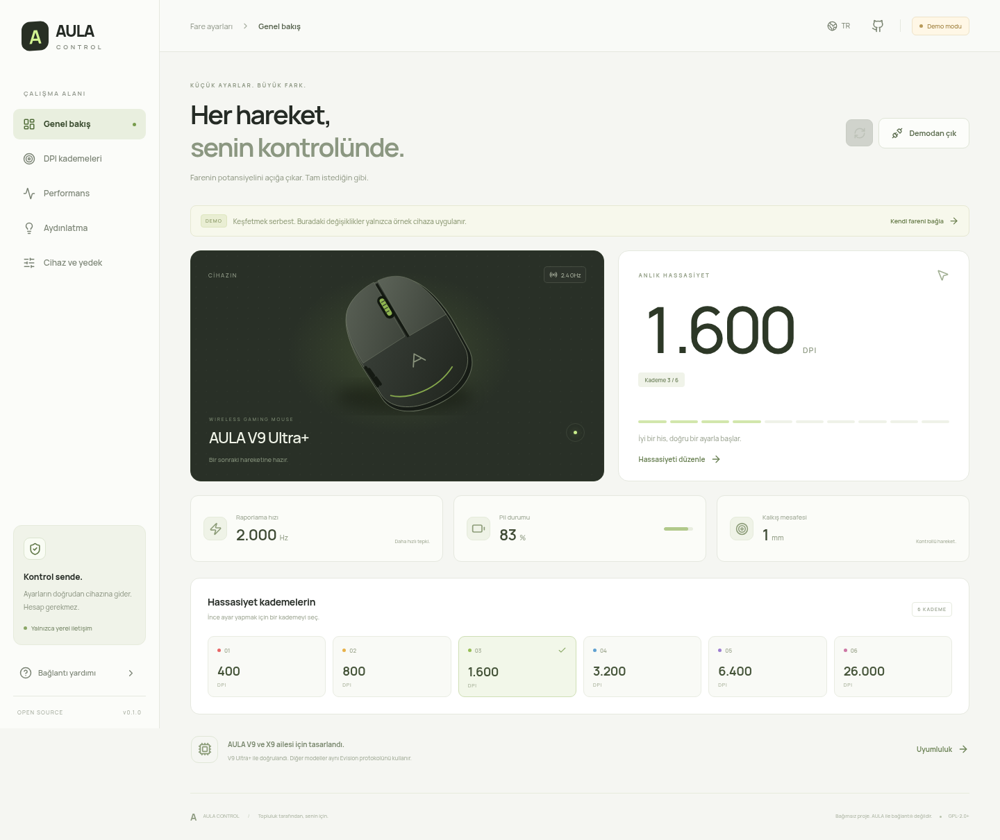

# AULA Control

A clean, open-source WebHID control panel for AULA gaming mice. Adjust DPI, polling rate,
sensor behavior, sleep, debounce and lighting directly in your browser.

**Türkçe / English UI · Windows / Linux / macOS compatible browsers · No account or backend**



## Use

1. Open the web panel in desktop Chrome, Edge, or another browser with WebHID enabled.
2. Connect your mouse by USB cable or its 2.4 GHz receiver.
3. Click **Connect mouse / Fareyi bağla**, select the AULA device in the browser's permission
   dialog, and connect.
4. Edit your settings, then click **Apply / Uygula**. Selecting a DPI tile only selects the
   editor; **Activate this stage** stages an active-stage change.

Previously authorized devices reconnect when you return. To explore without a mouse, use
**Explore the demo first / Önce demoyu keşfet**. Demo mode never writes to hardware.

WebHID requires HTTPS or localhost. Firefox, Safari and mobile browsers are not supported.
Bluetooth configuration is not supported. Windows and macOS have not yet been hardware-tested
by this project; desktop WebHID support and OS device access are required.

### Linux access

If the browser lists your mouse but cannot open it, save the following as
`/etc/udev/rules.d/70-aula-control.rules` with administrator privileges:

```udev
SUBSYSTEM=="hidraw", ATTRS{idVendor}=="320f", ATTRS{idProduct}=="22a0|22ba|22b6|22b7|22b8", TAG+="uaccess"
```

Run `sudo udevadm control --reload-rules`, then unplug and reconnect the receiver.
An existing Aulaar udev rule also provides access. Close other software controlling the same mouse.

## Supported devices

| Device                              | USB product ID | Status                                                     |
| ----------------------------------- | -------------- | ---------------------------------------------------------- |
| V9 Ultra+ through AULA 8K receiver  | `320f:22a0`    | Hardware read/write verified on CachyOS + Chromium         |
| V9+ / Pro+ / Ultra+ / Max+ by cable | `320f:22b7`    | Protocol support; wired operation not hardware-tested here |
| V9 / Pro / Ultra / Max              | `320f:22b8`    | Protocol support; not hardware-tested here                 |
| X9 / Pro / Ultra / Max              | `320f:22b6`    | Protocol support; not hardware-tested here                 |
| Older AULA 2.4G receiver            | `320f:22ba`    | Protocol support; not hardware-tested here                 |

Models are identified through their Evision `configId`; shared USB IDs alone do not identify a model.
This is not a universal AULA driver. Button remapping, macros, firmware updates and factory reset
are not part of this release.

## How changes work

- Communication uses the vendor configuration collection `0xFF1C/0x92` and HID report `4`.
- Configuration reads/writes transfer a 128-byte block in 24-byte wireless or 56-byte wired chunks.
- Edits are staged locally. Apply reads a fresh block and merges only edited fields, preserving
  unknown firmware bytes and unrelated changes made with the physical DPI button.
- Before the first write for a model, the original block is saved in this browser's local storage.
  You can download it or the current saved configuration from **Device & backup**.
- The write echo and a subsequent hardware read must match the requested block.
- Receiver status events, delayed chunks, malformed replies and disconnection are handled explicitly.
- Existing firmware values outside the documented SDK ranges are preserved when untouched.
  New invalid values are rejected. DPI is entered in steps of 50 between 100 and 42000; individual
  sensor/firmware variants may have lower limits.

Device settings are not sent to a server. Fonts and assets are served with the app; there is no
telemetry or analytics code. Your hosting provider still handles ordinary website requests.
Local backups are per model and browser, not a fleet backup system. JSON backup import/restore
is not implemented in this version.

## Development

Node.js 22.12+ (or a current supported Node release), npm:

```sh
npm ci
npm run dev
npm test
npm run build
npx playwright install chromium
npm run test:e2e
```

Open the printed localhost URL. For an existing Chromium executable, set
`PLAYWRIGHT_EXECUTABLE_PATH=/absolute/path/to/chrome` when running browser tests.

The suite contains 14 protocol tests and 3 browser tests. Hardware verification is documented in
[docs/TESTING.md](docs/TESTING.md). Automated CI uses simulated devices; it does not write to hardware.

## Vercel

Import this repository into Vercel. The included `vercel.json` selects Vite, `npm run build`,
and the `dist` output directory. No environment variables or secrets are needed.
Serve the app as a top-level HTTPS page so its device permission is scoped to its own origin.

## Contributing

Please report your model, wired/receiver connection, OS, browser version and USB VID:PID with a
reproducible description. Clearly distinguish a device detected by ID from a successful
hardware read/write. Do not include credentials, firmware images or personal browser data.
Test device changes on an inactive DPI stage and restore the starting values.

## Credits and license

The protocol implementation is ported from [Aulaar](https://github.com/shDavlatbek/aulaar),
Copyright (C) 2026 Davlatbek, and its reverse-engineered Evision protocol documentation.
This web adaptation is **GPL-2.0-or-later**. See [LICENSE](LICENSE) and [NOTICE](NOTICE).

Independent community software. Not affiliated with AULA.
